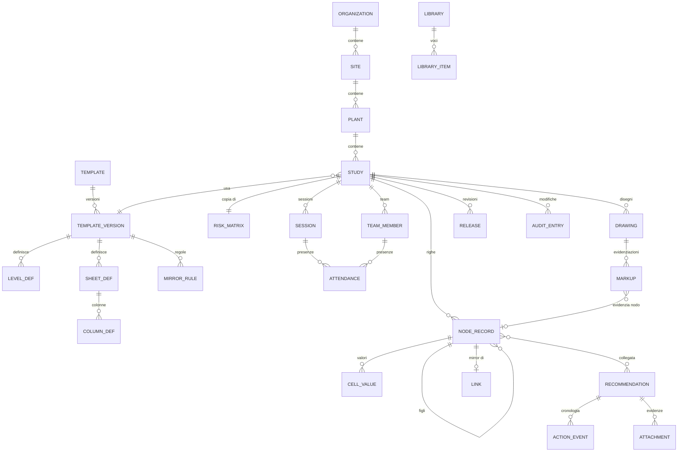

# 04 — Modello dati

Il modello separa **metadati del template** (che *forma* hanno i dati) dai **dati dello studio** (i contenuti). È ciò che permette a HAZOP, LOPA, What-If e FMEA di girare sullo stesso motore.

## Diagramma entità-relazioni



## Entità principali

### Struttura e template

| Entità | Campi chiave | Note |
|---|---|---|
| `Organization / Site / Plant` | id, nome, codice, parent | Albero organizzativo per permessi e report |
| `Template` | id, nome, metodologia, owner | Es. "HAZOP+LOPA aziendale" |
| `TemplateVersion` | id, template_id, versione, json_def, bloccata | Definizione completa immutabile dopo l'uso |
| `LevelDef` | key (keyword), label i18n, parent_key, cardinalità, ordine | Es. `node`, `deviation`, `cause`, `consequence`, `safeguard` |
| `SheetDef` | key, label, livelli mostrati, vista di default, filtri | Es. "HAZOP Worksheet", "LOPA", "Raccomandazioni" |
| `ColumnDef` | key, level_key, tipo, validazioni, default, formula, library_ref, autotype | Tipi: text, richtext, number, date, enum, multi_enum, user, link, computed, matrix_lookup, attachment |
| `MirrorRule` | sorgente (sheet/level), destinazione, condizione, campi mappati | Es. HAZOP→LOPA se `risk ≥ 15` |
| `RiskMatrix` | dimensioni, assi, celle (valore, colore, classe, azione), categorie impatto, frequenze | Copiata nello studio alla creazione |

### Dati dello studio

| Entità | Campi chiave | Note |
|---|---|---|
| `Study` | id, codice, titolo, plant_id, template_version_id, stato, revisione, campi form (JSON) | |
| `Record` (riga) | id, study_id, level_key, parent_id, ordine, numero visualizzato, session_id, stato | **Albero generico**: un nodo, una deviazione, una causa… sono tutti `Record` con livello diverso |
| `CellValue` | record_id, column_key, valore (JSON tipizzato), testo indicizzato | Valori in tabella EAV oppure colonna JSONB nel `Record` (scelta in [05](05-architettura.md)) |
| `Link` | record_id, target_record_id, tipo (mirror, riferimento incrociato) | Mirroring e "vedi nodo X" |
| `TeamMember`, `Session`, `Attendance` | | M3 |
| `Drawing`, `Markup` | file, pagina, revisione; geometria (poligono in coordinate PDF), colore, record_id | M4 |
| `Recommendation` | id leggibile, testo, priorità, owner, scadenza, stato, record collegati | Fuori dalla release, vive indipendente |
| `ActionEvent` | rec_id, da_stato, a_stato, utente, commento, timestamp | Workflow |
| `Release` | study_id, revisione, snapshot (blob), hash SHA-256, firme | Immutabile |
| `AuditEntry` | entità, id, campo, vecchio, nuovo, utente, timestamp, session_id | Append-only |
| `Library`, `LibraryItem` | scope (sistema/org/studio), tipo, testo i18n, attributi (frequenza, PFD, categoria), tag, fonte | M10 |

## Esempio: definizione di template (estratto JSON)

```json
{
  "template": "hazop-lopa",
  "version": "1.0.0",
  "levels": [
    { "key": "node",        "parent": null,          "label": {"it": "Nodo", "en": "Node"} },
    { "key": "deviation",   "parent": "node",        "label": {"it": "Deviazione", "en": "Deviation"} },
    { "key": "cause",       "parent": "deviation",   "label": {"it": "Causa", "en": "Cause"} },
    { "key": "consequence", "parent": "cause",       "label": {"it": "Conseguenza", "en": "Consequence"} },
    { "key": "safeguard",   "parent": "consequence", "label": {"it": "Salvaguardia", "en": "Safeguard"} }
  ],
  "columns": [
    { "key": "guideword", "level": "deviation", "type": "enum", "library": "guidewords" },
    { "key": "parameter", "level": "deviation", "type": "enum", "library": "parameters" },
    { "key": "severity",  "level": "consequence", "type": "enum", "source": "matrix.severity" },
    { "key": "likelihood","level": "consequence", "type": "enum", "source": "matrix.likelihood" },
    { "key": "risk",      "level": "consequence", "type": "computed",
      "formula": "matrix_lookup(severity, likelihood)" },
    { "key": "ipl_candidate", "level": "safeguard", "type": "boolean" },
    { "key": "pfd",       "level": "safeguard", "type": "number", "format": "sci" }
  ],
  "mirrors": [
    { "from": "consequence", "to_sheet": "lopa", "when": "risk.value >= 15",
      "fields": ["severity", "cause.text", "consequence.text"] }
  ]
}
```

## Calcoli chiave

| Calcolo | Formula |
|---|---|
| Rischio da matrice | `R = matrix[S][L]` (valore, colore, classe) |
| RPN (FMEA) | `RPN = S × O × D` |
| Frequenza mitigata LOPA | `MEF = f_IE × Π cm_i × Π PFD_j` (cm = modificatori abilitanti) |
| Fattore di riduzione richiesto | `RRF = MEF / TMEL` |
| SIL target | RRF ∈ (10, 100] → SIL 1; (100, 1.000] → SIL 2; (1.000, 10.000] → SIL 3; > 10.000 → SIL 4 / riprogettare; ≤ 10 → nessun SIL (eventuale IPL non SIS) |
| Durata sessione | `fine − inizio − pause` |

Tutti i numeri di frequenza/PFD sono memorizzati come `float64` e mostrati in notazione scientifica (`1.0E-03`).
