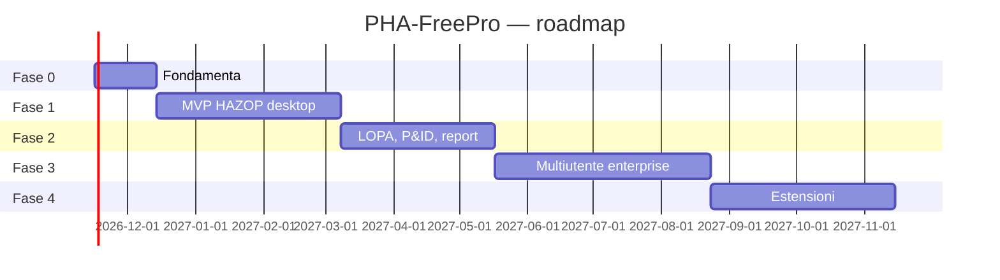

# PLANNER — Piano di progetto PHA-FreePro

Ultimo aggiornamento: 10 novembre 2026 · Owner: Luca Gruppi

Questo file è il **piano vivo** del progetto: obiettivi, fasi, milestone, backlog, decisioni, rischi. Aggiornare lo stato dei task con ogni PR (`[ ]` → `[~]` in corso → `[x]` fatto).

## 1. Obiettivo

Costruire uno strumento **open source** per PHA/HAZOP con parità funzionale sulle capacità chiave del prodotto commerciale di riferimento (vedi [00-ricerca-fonti.md](00-ricerca-fonti.md)): HAZOP, What-If, Checklist, LOPA collegata, matrice di rischio, librerie, Recommendations Manager, report Word/Excel, template configurabili, change tracking, sicurezza aziendale, multilingua.

**Fuori obiettivo**: copiare UI, testi, librerie o marchi del prodotto di riferimento; certificazioni formali (es. TÜV) nella v1.

## 2. Ipotesi di pianificazione

- Team di riferimento: 1 sviluppatore full-time + supporto di un esperto di process safety (revisione contenuti, ~1 g/settimana). Con 2–3 sviluppatori le fasi 2–4 si accorciano di circa il 40%.
- Sprint di **2 settimane**. Stime in giorni-persona (gp).
- Data di partenza: **lunedì 16 novembre 2026**.

## 3. Roadmap e milestone

| Fase | Contenuto | Sprint | Periodo indicativo | Milestone |
|---|---|---|---|---|
| **0 — Fondamenta** | Ricerca completata, decisioni, monorepo, CI, schema dati, motore template | S1–S2 | 16 nov – 11 dic 2026 | **M0**: "Hello worksheet" — un template JSON genera una griglia editabile |
| **1 — MVP HAZOP desktop** | Studi, dati studio, team/sessioni, worksheet HAZOP completo, matrice di rischio, librerie base, AutoType, raccomandazioni semplici, export Excel/Word, file `.phaf`, app Tauri singolo utente | S3–S8 | dic 2026 – mar 2027 | **M1 (v0.1)**: si conduce un HAZOP reale dall'inizio al report |
| **2 — LOPA, disegni, report** | LOPA collegata, SIL, P&ID con evidenziazione nodi, report completi e personalizzabili, What-If e Checklist, import Excel | S9–S13 | mar – giu 2027 | **M2 (v0.5)**: HAZOP+LOPA con P&ID e report da consegnare al cliente |
| **3 — Multiutente enterprise** | Server, PostgreSQL, sync offline, utenti/ruoli, LDAP/OIDC/2FA, Recommendations Manager completo con workflow e notifiche, audit trail, release firmate, confronto revisioni | S14–S20 | giu – ott 2027 | **M3 (v1.0)**: installazione on-premise per un'organizzazione |
| **4 — Estensioni** | Template designer visuale, FMEA, HAZID, Dependency Matrix, bow-tie, dashboard portafoglio, API pubblica + webhook, lingue aggiuntive, RTL | S21–S26 | ott 2027 – gen 2028 | **M4 (v1.5)** |

## 4. Backlog per fase

Formato: `ID` · descrizione · stima (gp) · dipende da · modulo ([03-moduli.md](03-moduli.md)).

### Fase 0 — Fondamenta

- [x] `RES-01` Ricerca pubblica sul prodotto di riferimento e redazione documentazione · 2 · — · docs
- [ ] `RES-02` Registrarsi alla demo series Sphera (5 video) e annotare flussi osservati in `00-ricerca-fonti.md` (solo descrizioni, niente screenshot) · 1 · —
- [ ] `RES-03` Studiare manuali pubblici di tool concorrenti (Open-PHA, PHAWorks) per i flussi LOPA · 1 · —
- [ ] `DEC-01` Confermare stack (vedi decisione D-01) · 0,5 · RES-01
- [ ] `DEC-02` Decidere il nome definitivo del progetto (rischio R-01) · 0,5 · —
- [ ] `ENG-01` Monorepo pnpm/Turborepo, lint, prettier, Vitest, CI GitHub Actions · 2 · DEC-01
- [ ] `ENG-02` `packages/core`: tipi del modello dati (Record, CellValue, TemplateDef…) · 3 · ENG-01 · [04](04-modello-dati.md)
- [ ] `ENG-03` Parser e validatore di template JSON (JSON Schema) · 3 · ENG-02 · M13
- [ ] `ENG-04` Motore formule (lookup matrice, aritmetica, condizionali) con test · 3 · ENG-02 · M5
- [ ] `ENG-05` Prototipo griglia virtualizzata con celle fuse gerarchiche · 5 · ENG-02 · M5
- [ ] `ENG-06` Schema DB Drizzle (SQLite) + migrazioni · 2 · ENG-02

### Fase 1 — MVP HAZOP desktop

- [ ] `M1-01` Elenco studi, nuovo da template, copia, archivia · 3 · ENG-06 · M1
- [ ] `M2-01` Form dati studio configurabile + documenti di riferimento · 3 · ENG-03 · M2
- [ ] `M3-01` Team, sessioni, presenze, marcatura righe per sessione · 4 · M1-01 · M3
- [ ] `M5-01` Editing tastiera completo (Tab, Invio, indent, move) · 5 · ENG-05 · M5
- [ ] `M5-02` Undo/redo, trova/sostituisci, filtri, numerazione automatica · 4 · M5-01
- [ ] `M5-03` AutoType (studio + libreria, fuzzy) · 4 · M5-01, M10-01
- [ ] `M5-04` Copy From (da studio/libreria) e duplicazione nodo · 3 · M5-01
- [ ] `M5-05` Validazioni e pannello problemi · 3 · ENG-04
- [ ] `M6-01` Template HAZOP di serie (gerarchia, colonne, liste guideword/parametri IT/EN) · 3 · ENG-03 · M6
- [ ] `M6-02` Generatore deviazioni (matrice guideword × parametro) · 2 · M6-01
- [ ] `M8-01` Matrice di rischio: modello, editor, rischio iniziale/residuo, colori · 5 · ENG-04 · M8
- [ ] `M10-01` Librerie: modello, import CSV, ricerca; contenuti base (guideword, parametri, 150 cause, 150 salvaguardie) · 5 · ENG-06 · M10
- [ ] `M11-01` Raccomandazioni base: elenco, owner, scadenza, stato, link a righe · 4 · M5-01 · M11
- [ ] `M12-01` Export XLSX worksheet (round-trip) · 3 · M6-01 · M12
- [ ] `M12-02` Report DOCX base (dati studio, team, presenze, worksheet, raccomandazioni) · 5 · M6-01
- [ ] `M14-01` Audit trail locale (log operazioni) · 3 · ENG-06 · M14
- [ ] `FMT-01` File `.phaf` import/export · 3 · ENG-06
- [ ] `DSK-01` App Tauri, installer Windows, salvataggio automatico · 4 · ENG-01
- [ ] `I18N-01` Infrastruttura i18n, UI IT/EN · 2 · ENG-01 · M16
- [ ] `QA-01` Pilota: HAZOP di esempio completo (impianto didattico) rivisto dall'esperto · 3 · tutti

### Fase 2 — LOPA, disegni, report

- [ ] `M9-01` Template LOPA, mirroring HAZOP→LOPA con regola condizionale · 5 · M5-01 · M9
- [ ] `M9-02` Calcoli MEF/TMEL/RRF/SIL, catena grafica scenario · 4 · M9-01
- [ ] `M9-03` Librerie IE e IPL (frequenze/PFD tipiche da letteratura pubblica, con fonte) · 3 · M10-01
- [ ] `M9-04` Regole di validazione IPL (indipendenza, PFD minime) · 3 · M9-02
- [ ] `M9-05` Riepilogo SIF/SIL ed export SRS preliminare · 3 · M9-02
- [ ] `M4-01` Visualizzatore PDF/immagini con revisioni · 4 · — · M4
- [ ] `M4-02` Evidenziazione nodi (poligoni) e link bidirezionale · 5 · M4-01
- [ ] `M4-03` Export PDF dei disegni evidenziati · 2 · M4-02
- [ ] `M7-01` Template What-If + libreria domande · 3 · M6-01 · M7
- [ ] `M7-02` Template Checklist + libreria (obiettivo 1.000 voci in questa fase) · 6 · M10-01
- [ ] `M12-03` Report completo personalizzabile (template DOCX con segnaposto), PDF, HTML · 6 · M12-02
- [ ] `M12-04` Heat map rischio iniziale/residuo · 2 · M8-01
- [ ] `M18-01` Wizard import da Excel · 4 · M6-01 · M18
- [ ] `M5-06` Link/riferimenti incrociati e mirroring nodo master · 4 · M9-01
- [ ] `M5-07` Modalità presentazione · 1 · M5-01

### Fase 3 — Multiutente enterprise

- [ ] `SRV-01` Server Fastify + PostgreSQL, API REST OpenAPI · 6 · ENG-06
- [ ] `SRV-02` Protocollo di sync a operazioni, offline e risoluzione conflitti · 8 · SRV-01
- [ ] `SRV-03` WebSocket: presenza e aggiornamenti live, lock sessione · 3 · SRV-02
- [ ] `M15-01` Utenti, ruoli, permessi per sito/studio · 5 · SRV-01 · M15
- [ ] `M15-02` LDAP/AD, OIDC, TOTP 2FA · 5 · M15-01
- [ ] `M11-02` Workflow raccomandazioni configurabile, evidenze, proroghe · 5 · M11-01
- [ ] `M11-03` Notifiche e-mail e job scadenze · 3 · M11-02
- [ ] `M11-04` Portale "Le mie azioni" (mobile friendly) e dashboard · 4 · M11-02
- [ ] `M14-02` Release firmate con hash, lock, confronto revisioni · 5 · M14-01
- [ ] `M1-02` Gerarchia organizzazione/sito/impianto, revalidation · 3 · M15-01
- [ ] `OPS-01` Docker Compose, backup/restore, guida installazione on-premise · 3 · SRV-01
- [ ] `SEC-01` Revisione sicurezza (OWASP ASVS L2) e penetration test interno · 4 · M15-02
- [ ] `QA-02` Test di carico (studio 5.000 righe, 20 utenti) · 2 · SRV-03

### Fase 4 — Estensioni

- [ ] `M13-01` Template designer visuale · 10 · ENG-03 · M13
- [ ] `M7-03` Template FMEA (RPN / Action Priority) · 3 · M13-01
- [ ] `M7-04` Template HAZID · 2 · M13-01
- [ ] `M13-02` Dependency Matrix (matrici N×M) · 4 · M13-01
- [ ] `M17-01` Vista bow-tie generata dagli scenari + export SVG/JSON · 6 · M9-01 · M17
- [ ] `M12-05` Report di portafoglio multi-studio · 4 · SRV-01
- [ ] `M18-02` Webhook, API pubblica documentata, esempio integrazione CMMS · 4 · SRV-01
- [ ] `M10-02` Knowledge base aziendale: promozione righe in libreria con approvazione · 3 · M15-01
- [ ] `M7-05` Libreria checklist fino a ≥ 2.500 voci · 8 · M7-02
- [ ] `I18N-02` Lingue DE/FR/ES/PT/JA/ZH/KO e dati RTL · 5 · I18N-01

**Totale stimato:** Fase 0 ≈ 24 gp · Fase 1 ≈ 71 gp · Fase 2 ≈ 55 gp · Fase 3 ≈ 56 gp · Fase 4 ≈ 49 gp → **≈ 255 gp** (+20% di contingenza ≈ 305 gp, circa 14 mesi-persona).

## 5. Registro decisioni

| ID | Decisione | Stato | Note |
|---|---|---|---|
| D-01 | Stack TypeScript end-to-end (React, Fastify, Drizzle, PostgreSQL/SQLite, Tauri) | **Proposta** | Alternativa valutata: Python FastAPI + React. Scelto TS per condividere il motore di calcolo client/server e lavorare offline. Vedi [05-architettura.md](05-architettura.md) |
| D-02 | Metodologie come template JSON su motore generico | Approvata | È il principio del prodotto di riferimento ("Hierarchy", "Sheets", "Keyword") |
| D-03 | Desktop singolo utente prima del server (Fase 1) | Approvata | Valore immediato per consulenti/facilitatori |
| D-04 | Contenuti di libreria scritti da zero o da fonti di pubblico dominio, con fonte citata | Approvata | Evita violazioni di copyright |
| D-05 | Licenza MIT | Approvata | Già nel repository |

## 6. Registro rischi

| ID | Rischio | Prob. | Impatto | Mitigazione |
|---|---|---|---|---|
| R-01 | Il nome "PHA-FreePro" richiama il marchio registrato "PHA-Pro" → possibile contestazione | Media | Alto | Valutare un nome distinto prima del primo rilascio pubblico (`DEC-02`); non usare logo/colori Sphera |
| R-02 | Informazioni pubbliche sul prodotto di riferimento scarse (guida e video non accessibili liberamente) | Alta | Medio | Basarsi su norme (IEC 61882, CCPS) e sull'esperto di dominio; `RES-02`, `RES-03` |
| R-03 | Griglia gerarchica complessa e lenta | Media | Alto | Prototipo anticipato in Fase 0 (`ENG-05`) con test a 5.000 righe |
| R-04 | Sync offline con conflitti | Media | Alto | Modello a operazioni, LWW per cella, lock di sessione; test dedicati |
| R-05 | Errori nei calcoli LOPA/SIL usati per decisioni di sicurezza | Bassa | Molto alto | Test unitari con casi da letteratura, revisione dell'esperto, disclaimer, calcoli tracciabili |
| R-06 | Creare 2.500 voci di checklist richiede molto tempo di dominio | Alta | Medio | Crescita progressiva (1.000 in Fase 2), contributi della community |
| R-07 | Generazione DOCX fedele e personalizzabile | Media | Medio | Template DOCX con segnaposto; test visivi |

## 7. Definition of Done (per ogni task)

1. Codice con test (unità ≥ 80% su `core` e `risk`; E2E per i flussi principali).
2. Criteri di accettazione del modulo in [03-moduli.md](03-moduli.md) verificati.
3. Testi UI tradotti IT/EN.
4. Documentazione aggiornata (`docs/`), changelog, stato in questo planner.
5. Code review approvata, CI verde.

## 8. Rituali

- **Pianificazione sprint** (lunedì, inizio sprint): selezione dal backlog e aggiornamento di questo file.
- **Demo** (venerdì, fine sprint): demo all'esperto di process safety su un caso reale.
- **Retro** mensile: aggiornare rischi e stime.
